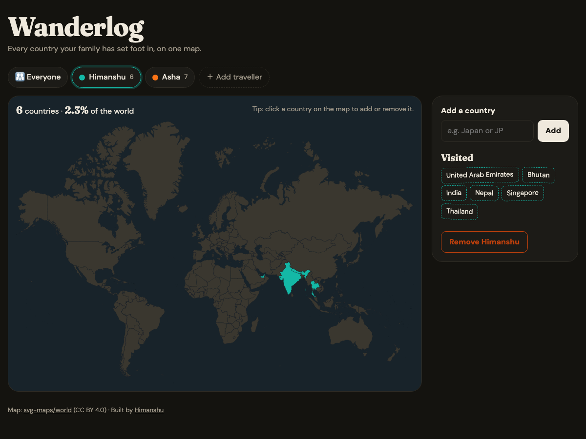

# 🗺️ Wanderlog

> A family travel tracker: every traveller gets their own colour, and the countries they've visited light up on a shared world map. **Click the map** to add or remove a country. Built with Express, EJS and **PostgreSQL**.

[](https://github.com/himanshuuem/wanderlog/actions/workflows/test.yml)




## ✨ Features

- **Multiple travellers**, each with a custom colour picked from a palette or a colour input.
- **An interactive SVG world map** with 256 regions, rendered server-side. Click a country to toggle it, or type a name or ISO code with autocomplete.
- **A family view** where countries are shaded by how many of you have been there, with hover tooltips.
- **Smart country lookup in SQL:** exact name, then ISO code, then prefix, then substring, ranked in a single query, so *"united k"* finds the United Kingdom and *"JP"* finds Japan. Wildcards in user input are escaped.
- **Stats:** countries visited and the percentage of the world.
- **Data integrity in the database:** foreign keys, `ON DELETE CASCADE` (removing a traveller removes their visits), a composite primary key that prevents duplicate visits, a `UNIQUE` traveller name and a `CHECK` on hex colours. Friendly errors map Postgres code `23505` to a readable message.
- The country table is **seeded from the map data itself** with one `unnest()` bulk insert, so the database and the SVG can never disagree.

## 🗄️ Schema

```sql
countries  (code VARCHAR(6) PK, name)
travellers (id SERIAL PK, name UNIQUE, color CHECK ~ '^#[0-9a-fA-F]{6}$')
visits     (traveller_id FK → travellers ON DELETE CASCADE, country_code FK → countries,
            added_at, PRIMARY KEY (traveller_id, country_code))
```

## 🚀 Run Locally

```bash
git clone https://github.com/himanshuuem/wanderlog.git
cd wanderlog
npm install
cp .env.example .env     # set DATABASE_URL
npm run db:setup         # tables + 256 countries + two demo travellers
npm run dev              # http://localhost:3000
DATABASE_URL=postgres://... npm test
```

## ☁️ Deploy (free)

`render.yaml` creates a free Postgres instance and web service and runs `db:setup` during the build.

## 📚 Origin

This is a reimagined **Family Travel Tracker** from the PostgreSQL section of [The Complete Web Development Bootcamp](https://www.udemy.com/course/the-complete-web-development-bootcamp/). The map is [svg-maps/world](https://github.com/VictorCazanave/svg-maps) (CC BY 4.0).

---

Made by [Himanshu](https://github.com/himanshuuem)
